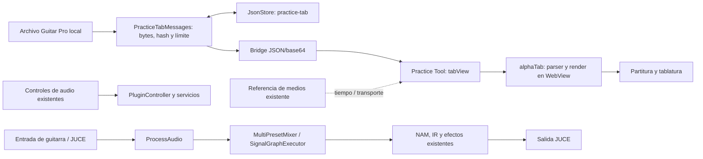

# Arquitectura base y recomendada

Inspección de `a9f4fec1123d51218e090decaceec44c455740b5`, 2026-11-17.
La descripción general upstream sigue en [architecture-overview](../architecture-overview.md).
Este documento precisa lo necesario para Guitar Studio y distingue código existente
de decisiones por validar.

## Mapa del repositorio

| Área | Responsabilidad real |
| --- | --- |
| `core/src/` | C++20 compartido: controlador, servicios, presets, almacenamiento y DSP |
| `core/src/controller/` | Servicios y unidades del controlador por dominio |
| `core/src/dsp/` | Mixer, grafos, NAM, IR, efectos, metrónomo y looper |
| `core/ui/` | SPA HTML/CSS/TypeScript en WebView; `tsc`, ensamblado HTML y copia de vendor, sin bundler |
| `core/protocol/` | Contratos compartidos y comprobaciones del protocolo |
| `juce/` | Host Standalone y plugins, dispositivos, callback y WebView; WKWebView en macOS |
| `nanoq/` | UI nativa alternativa; no dispone del visor de tablaturas |
| `android/`, `ios/` | Hosts móviles, fuera de la aceptación inicial |
| `core/tests/`, `juce/tests/`, `tools/` | Pruebas, benchmarks y herramientas existentes |
| `.github/workflows/`, `build_macos.sh` | CI y empaquetado existentes |

## Flujos existentes

El esquema separa responsabilidades; no sustituye el detalle de mezcla en
[signal-chain](../signal-chain.md). `PluginProcessorAdapter.cpp` llama a
`PluginController::ProcessAudio`; `ProcessAudioLocked` procesa el mixer y después
mezcla metrónomo y backing track mediante `PracticeToolService::RenderPostChain`.
Este backing track es audio existente, distinto del render de notación.

**Precisión sobre tiempo real:** el callback actual usa `mDSPMutex` con
`try_to_lock`; si no lo obtiene en tiempo real devuelve `false` y el adapter puede
entregar silencio. En offline espera. No es una ruta íntegramente lock-free,
aunque algunas colas/intercambios sí lo sean. No se modifica esa política en Fase 0.

## Frontera del visor

El detalle funcional vive en [practice-tool-tablature](../practice-tool-tablature.md).
Los puntos de extensión ya existen:

| Contrato | Implementación |
| --- | --- |
| Fachada de la vista | `core/ui/ts/practiceTool/tab.ts` y `tab/tabView.ts` |
| Ciclo de vida y estado | `tab/session.ts`, `tab/tabState.ts`, `tab/panel.ts` |
| Carga diferida | `tab/alphaTabLoader.ts`, script clásico local |
| Importación | `browsePracticeToolTab`, `importPracticeToolTabData` |
| Recuperación/respuesta | `requestPracticeToolTab`, `practiceToolTabLoaded`, `practiceToolTabFailed` |
| Almacenamiento | `core/src/controller/PracticeTabMessages.{h,cpp}`, `JsonStore`, ID por hash |
| Recursos empaquetados | `core/ui/scripts/copy-vendor.js`: alphaTab, LICENSE, Bravura y OFL |

### Mapa de reutilización comprobado el 2026-11-18

La instalación desde el lockfile confirmó `@coderline/alphatab` **1.9.0** y el build
UI copió los seis assets vendor previstos (incluido jszip). El flujo reutilizable es:

| Capacidad existente | Punto de entrada y recorrido | Reutilización en Fase 1 |
| --- | --- | --- |
| Abrir por diálogo | `panel.ts:300` → `browsePracticeToolTab` → `PracticeTabMessages.cpp:79` → selector en `PluginProcessorAdapter.cpp:1031` | Probar archivos reales, conservar diálogo y contrato |
| Arrastrar archivo | `panel.ts:278` → `File.arrayBuffer()` → base64 → `importPracticeToolTabData` | Conservar puente portable; comprobar errores y consumo antes del límite nativo |
| Guardar/recuperar bytes | `PracticeTabMessages.cpp`: hash, `JsonStore` tipo `practice-tab`, `requestPracticeToolTab` y respuestas Loaded/Failed | Reutilizar deduplicación/recall; no crear otra biblioteca ni parser C++ |
| Interpretar y dibujar | `session.ts:170` convierte base64 a `Uint8Array`; `tabView.ts:304` llama `AlphaTabApi.load(bytes, [trackIndex])` | Validar GP3–8 en WebKit; no escribir un lector |
| Cambiar pista/vista | `panel.ts:305`, `tabView.ts:327`: `renderTracks`, perfiles Tab/ScoreTab/Score | Usar controles y estado existentes; escala inicial 0.9, sin prometer un control de zoom nuevo |
| Persistencia | `tabState.ts`: `tabId`, `trackIndex`, sync; `practiceTool.tabs` guarda hasta 300 referencias; `practiceTool.tabStaves` conserva vista | Probar proyectos existentes y archivo original movido |
| Referencia y cursor | `reference.ts`, `youtubeReference.ts`, `syncPoints.ts` y modo `EnabledExternalMedia` | Mantener el transporte existente; vista estática sin referencia y sin síntesis propia |
| Ciclo de vida/recursos | `alphaTabLoader.ts` carga script local una vez; `tabView.ts:315` destruye API al cerrar | Comprobar worker, Bravura, recuperación y ciclos en WKWebView |

Los filtros GP del diálogo son `.gp`, `.gpx`, `.gp3`, `.gp4`, `.gp5`; el arrastre
acepta además `.gp7`. Ambos admiten MusicXML, Capella y alphaTex por las extensiones
de su lista. Esta asimetría heredada se registra, sin corregirla en Fase 0.
La extensión no certifica el formato ni la fidelidad del parser. El límite nativo
es 16 MiB; el arrastre lee el archivo completo en JS antes de enviarlo, por lo que
el límite no demuestra por sí solo acotación de memoria en la WebView.

La suite UI original pasó 172 archivos / 1.455 tests en esta revisión. Es evidencia
de lógica y contratos simulados, no una prueba de render GP real o audio simultáneo.
Los resultados de build nativo y de agentes se mantienen en [validación](validation.md).

El C++ lee/almacena bytes y responde al bridge; no parsea Guitar Pro. La importación
rechaza vacíos y archivos de más de 16 MiB, con comprobación previa del tamaño
base64 en el flujo de arrastre. La UI interpreta el contenido. No se introduce
otro contrato ni persistencia en paralelo.

alphaTab usa `PlayerMode.EnabledExternalMedia`: no hay soundfont ni síntesis de
partitura. Un cursor puede seguir el transporte existente; el MVP también admite
vista estática sin referencia. El modo externo no significa que el visor carezca
de efectos sobre el transporte: hay solicitudes de seek/play/pause que deben
mantener sus salvaguardas actuales y probarse.

Recomendación: conservar esta frontera, assets locales y carga bajo demanda.
Verificar worker, fuentes, CSP y esquema `juce:` en WKWebView antes de ratificar
[ADR 0002](../adr/0002-reuse-alphatab-viewer.md). No trasladar importación, parsing,
renderizado ni logging al callback; tampoco añadir un puente del visor al grafo DSP.

## Compilación y dependencias

| Componente | Base observada |
| --- | --- |
| CMake / lenguaje | Host ≥3.25, core ≥3.22; C++20 |
| JUCE | Submódulo; versión requerida 9.0.5; macOS deployment target 11.0 por defecto |
| Eigen | Submódulo preferido; fallback FetchContent 5.0.1 |
| NeuralAmpModelerCore | Fork DLC86, revisión `bea723b300e2dfe54f417c9e9f9d7f68b4a8f30d` |
| AudioDSPTools | Revisión `63bdfc9db16cb45da8f1dcb3af4c572286753dde`; parches CMake existentes |
| Otros DSP | FusedWaveNet/NEON arm64, Signalsmith Linear/Stretch y stftPitchShift |
| Infraestructura | nlohmann/json, miniz 3.1.2, SQLite 3.54.1, Wasmtime 48.0.8 |
| UI | alphaTab 1.9.0, jszip; TypeScript, ESLint y Vitest/jsdom |

Las fuentes de versiones son [core/CMakeLists](../../core/CMakeLists.txt),
`core/cmake/`, [juce/CMakeLists](../../juce/CMakeLists.txt), submódulos y
[package-lock](../../core/ui/package-lock.json). No se actualizan durante esta fase.
Existe una divergencia heredada: el host aporta nlohmann/json 3.11.3 y el core
independiente pide 3.12.0. Debe constar al comparar builds, no corregirse aquí.

`build_macos.sh` construye universal e instalador por defecto, limpia su staging y
solicita AAX junto con otros formatos. Para validar el MVP se recomienda CMake
directo al target Standalone arm64, sin instalar plugins. Ninja es opcional;
Unix Makefiles es una alternativa. Comandos y bloqueos en [validación](validation.md).
El deployment target del binario no demuestra que todas las APIs WebKit del visor
funcionen desde macOS 11; el mínimo soportado del producto queda por comprobar.
